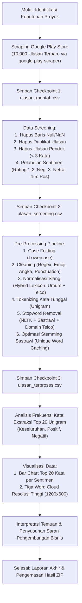
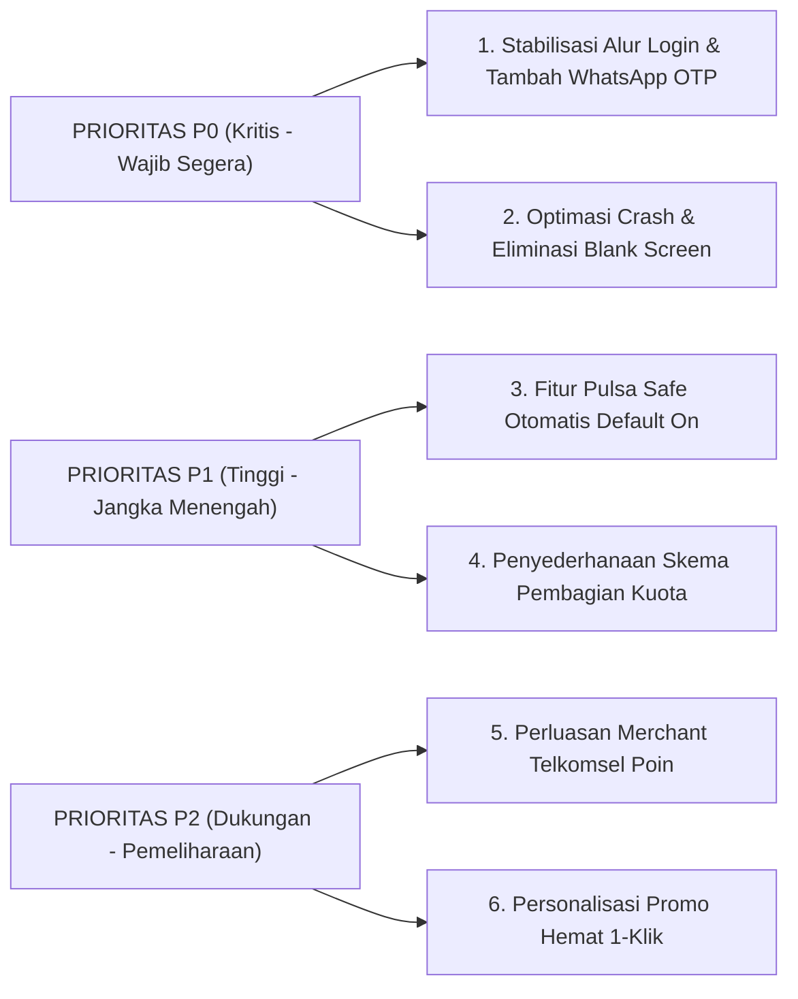

# LAPORAN TUGAS BESAR MACHINE LEARNING & BIG DATA
## ANALISIS ULASAN PENGGUNA TERHADAP APLIKASI MYTELKOMSEL PADA GOOGLE PLAY STORE MELALUI TAHAPAN PRE-PROCESSING DATA DAN VISUALISASI WORD CLOUD

---

**Mata Kuliah:** Machine Learning & Big Data (Semester 5)  
**Kelompok / Penyusun:** Tim Peneliti (JRS + KC)  
**Program Studi:** Informatika / Ilmu Komputer / Sistem Informasi  
**Objek Penelitian:** Aplikasi MyTelkomsel (`com.telkomsel.telkomselcm`) di Google Play Store  
**Ukuran Dataset:** 10.000 Ulasan Pengguna Terbaru  
**Lingkungan Komputasi:** Python 3 (Google Colab Environment)  

---

## DAFTAR ISI
1. [BAB 1: PENDAHULUAN](#bab-1-pendahuluan)
   - 1.1 Latar Belakang
   - 1.2 Rumusan Masalah
   - 1.3 Tujuan Penelitian
   - 1.4 Manfaat Penelitian
2. [BAB 2: TINJAUAN PUSTAKA](#bab-2-tinjauan-pustaka)
   - 2.1 Text Mining & Pemrosesan Bahasa Alami (NLP)
   - 2.2 Tahapan Pre-Processing Data Teks Bahasa Indonesia
   - 2.3 Pelabelan Sentimen Berbasis Skor Rating (Proxy Sentiment)
   - 2.4 Analisis Frekuensi Kata (Unigram) dan Visualisasi Word Cloud
3. [BAB 3: METODOLOGI PENELITIAN](#bab-3-metodologi-penelitian)
   - 3.1 Diagram Alir Penelitian (Research Flowchart)
   - 3.2 Pengumpulan Data (Scraping Google Play Store)
   - 3.3 Data Screening & Kriteria Eliminasi
   - 3.4 Desain Pipeline Pre-Processing
   - 3.5 Optimasi Stemming Sastrawi: *Unique Word Caching*
4. [BAB 4: HASIL DAN PEMBAHASAN](#bab-4-hasil-dan-pembahasan)
   - 4.1 Karakteristik Dataset & Distribusi Sentimen
   - 4.2 Analisis Transformasi Teks per Tahap Pre-Processing (Tabel Sampel)
   - 4.3 Analisis Frekuensi Kata Teratas (Top 20 Unigram)
   - 4.4 Interpretasi Visualisasi Word Cloud (Keseluruhan, Positif, Negatif)
5. [BAB 5: SARAN PENGEMBANGAN APLIKASI](#bab-5-saran-pengembangan-aplikasi)
   - 5.1 Matriks Masalah vs Solusi Strategis
   - 5.2 Rencana Aksi Prioritas (Action Plan)
6. [BAB 6: KESIMPULAN DAN SARAN](#bab-6-kesimpulan-dan-saran)
   - 6.1 Kesimpulan
   - 6.2 Saran Penelitian Selanjutnya
7. [LAMPIRAN](#lampiran)
   - Lampiran 1: Ringkasan Kode Program
   - Lampiran 2: Panduan Menjalankan Notebook di Google Colab

---

## BAB 1: PENDAHULUAN

### 1.1 Latar Belakang
Di era transformasi digital saat ini, aplikasi *self-service* operator seluler memegang peranan krusial sebagai titik kontak (*customer touchpoint*) utama antara penyedia layanan telekomunikasi dan jutaan pelanggannya. PT Telekomunikasi Selular (Telkomsel), sebagai operator seluler terbesar di Indonesia dengan lebih dari 150 juta pelanggan, menyediakan aplikasi **MyTelkomsel** untuk memfasilitasi transaksi pembelian pulsa, paket kuota internet, pembayaran tagihan Pascabayar (Halo), penukaran poin loyalitas, hingga layanan keluhan digital.

Google Play Store menyediakan platform bagi para pengguna untuk menyampaikan pengalaman, aspirasi, keluhan teknis, maupun pujian dalam bentuk ulasan (*user reviews*) dan rating skor bintang (1 hingga 5). Ulasan-ulasan ini merupakan sumber data besar (*Big Data*) yang sangat bernilai tinggi. Namun, data ulasan berbentuk teks tidak terstruktur (*unstructured text*) yang sarat dengan bahasa gaul (slang), singkatan tidak baku, kesalahan penulisan (*typo*), tanda baca berulang, dan emoji.

Oleh karena itu, diperlukan tahapan **Pre-Processing Data Teks** yang sistematis untuk mengubah teks ulasan mentah menjadi korpus data bersih (*clean dataset*). Dengan memanfaatkan teknik analisis frekuensi unigram dan visualisasi **Word Cloud**, kata-kata kunci dominan yang merefleksikan sentimen positif maupun negatif dapat diidentifikasi secara tajam, sehingga menghasilkan rekomendasi strategis bagi tim pengembang aplikasi MyTelkomsel.

### 1.2 Rumusan Masalah
Berdasarkan latar belakang tersebut, rumusan masalah dalam penelitian ini adalah:
1. Bagaimana tahapan *pre-processing* data teks ulasan aplikasi MyTelkomsel agar siap dianalisis tanpa kehilangan makna konteks?
2. Bagaimana mendesain algoritma *stemming* bahasa Indonesia yang efisien untuk korpus ulasan berukuran besar (10.000 ulasan) tanpa mengalami *bottleneck* komputasi?
3. Kata-kata (unigram) apa yang paling dominan muncul pada ulasan pengguna secara keseluruhan, ulasan positif, dan ulasan negatif?
4. Rekomendasi perbaikan dan pengembangan fitur apa yang dapat dirumuskan secara terukur berdasarkan temuan visualisasi Word Cloud?

### 1.3 Tujuan Penelitian
Tujuan dari pelaksanaan proyek penelitian ini adalah:
1. Menerapkan secara komprehensif seluruh tahapan *text pre-processing* (Case Folding, Cleaning, Normalisasi Slang, Tokenizing, Stopword Removal, dan Stemming) pada 10.000 ulasan MyTelkomsel.
2. Mengimplementasikan teknik optimasi *Unique Word Caching* pada algoritma *stemmer* Sastrawi untuk memangkas waktu eksekusi secara drastis di Google Colab.
3. Menghasilkan visualisasi Word Cloud beresolusi tinggi dan grafik batang frekuensi kata untuk ulasan keseluruhan, positif, dan negatif.
4. Menyusun matriks rekomendasi pengembangan aplikasi berbasis data (*data-driven product improvements*).

### 1.4 Manfaat Penelitian
* **Bagi Akademik:** Memberikan dokumentasi empiris mengenai metodologi pembersihan data teks bahasa Indonesia berskala besar beserta mitigasi masalah efisiensi komputasi *stemming*.
* **Bagi Industri & Pengembang Aplikasi:** Memberikan *actionable feedback* yang nyata mengenai prioritas keluhan teknis pengguna (seperti kegagalan OTP, aplikasi lambat, dan transparansi kuota/pulsa).

---

## BAB 2: TINJAUAN PUSTAKA

### 2.1 Text Mining & Pemrosesan Bahasa Alami (NLP)
*Text Mining* adalah proses penemuan informasi baru dan pola yang bermakna dari kumpulan teks yang tidak terstruktur. Berbeda dengan data tabular yang memiliki skema terdefinisi, teks bebas memiliki kompleksitas tinggi karena variasi sintaksis dan semantik. *Natural Language Processing* (NLP) menyediakan seperangkat teori dan algoritma komputasi untuk menganalisis dan memproses bahasa alami manusia.

### 2.2 Tahapan Pre-Processing Data Teks Bahasa Indonesia
Tahapan *pre-processing* bertujuan untuk menstandardisasi korpus teks. Tahapan standar meliputi:
1. **Case Folding:** Menyamakan format huruf kapital menjadi huruf kecil (*lowercase*) agar representasi kata bersifat seragam (misal: "Kuota", "KUOTA", dan "kuota" dianggap sebagai satu entitas identik).
2. **Text Cleaning / Regex Filtering:** Menghilangkan elemen non-linguistik seperti URL, mention (@user), angka, simbol tanda baca, serta karakter emoji.
3. **Normalisasi Slang / Kata Baku:** Memetakan singkatan atau kata gaul khas media sosial ke dalam bentuk kata baku bahasa Indonesia (misal: "gk" $\rightarrow$ "tidak", "lemot" $\rightarrow$ "lambat", "bgt" $\rightarrow$ "banget").
4. **Tokenizing:** Proses pemotongan runtutan karakter kalimat menjadi unit-unit kata tunggal (*tokens/unigrams*).
5. **Stopword Removal:** Eliminasi kata hubung dan kata umum yang memiliki frekuensi kemunculan tinggi namun minim muatan informasi semantik (seperti "dan", "yang", "di", "ke"). Pada domain tertentu, stopword domain spesifik perlu ditambahkan (misal nama entitas aplikasi "telkomsel" atau "aplikasi").
6. **Stemming:** Proses morfologis untuk menghilangkan afiks (prefiks, infiks, sufiks, dan konfiks) guna mengembalikan kata turunan ke bentuk kata dasarnya (misal: "membeli", "dibelikan" $\rightarrow$ "beli"). Di Indonesia, algoritma Confix Stripping yang diimplementasikan pada library **Sastrawi** menjadi standar utama.

### 2.3 Pelabelan Sentimen Berbasis Skor Rating (Proxy Sentiment)
Dalam analisis ulasan aplikasi seluler, skor rating bintang (1 sampai 5) yang diberikan oleh pengguna secara konsisten merefleksikan tingkat kepuasan mereka. Oleh karena itu, skor rating dapat digunakan sebagai variabel *proxy* sentimen:
* **Sentimen Negatif:** Rating 1 dan 2 (menunjukkan ketidakpuasan, bug, atau kekecewaan).
* **Sentimen Netral:** Rating 3 (menunjukkan ulasan campuran atau evaluasi moderat).
* **Sentimen Positif:** Rating 4 dan 5 (menunjukkan kepuasan, apresiasi fitur, atau kemudahan transaksi).

### 2.4 Analisis Frekuensi Kata (Unigram) dan Visualisasi Word Cloud
* **Unigram:** Pasangan frekuensi kata tunggal dalam dokumen teks. Distribusi unigram mengikuti Hukum Zipf (*Zipf's Law*), di mana sebagian kecil kata memiliki frekuensi kemunculan yang sangat dominan.
* **Word Cloud:** Teknik representasi visual grafis di mana ukuran (*font size*) setiap kata berbanding lurus dengan frekuensi kemunculannya di dalam kumpulan data teks. Skema warna (*colormap*) yang tematik memudahkan pembaca membedakan konteks sentimen positif (hijau) dan negatif (merah).

---

## BAB 3: METODOLOGI PENELITIAN

### 3.1 Diagram Alir Penelitian (Research Flowchart)

Alur pelaksanaan proyek penelitian ini digambarkan melalui diagram alir berikut:

### 3.2 Pengumpulan Data (Scraping Google Play Store)
Data dikumpulkan secara terprogram menggunakan pustaka `google-play-scraper` pada package ID `com.telkomsel.telkomselcm`. 
* **Metode:** *Natural Sampling* (mengambil ulasan berurutan dari yang paling baru menggunakan parameter `Sort.NEWEST`, tanpa memfilter skor bintang tertentu). Hal ini bertujuan untuk menangkap proporsi sentimen riil pengguna terhadap versi aplikasi yang sedang aktif di pasar.
* **Volume:** Ditargetkan tepat **10.000 ulasan** dengan pengambilan bertahap (*batching* sebesar 200 ulasan per iterasi) disertai jeda waktu (*rate-limiting delay*) 0,5 detik guna mencegah pemblokiran IP oleh Google Play API.
* **Metadata yang Diekstraksi:** `content` (teks ulasan), `score` (skor bintang 1–5), `at` (tanggal dan waktu ulasan), `appVersion` (versi aplikasi saat ulasan dibuat), dan `thumbsUpCount` (jumlah dukungan pengguna lain).

### 3.3 Data Screening & Kriteria Eliminasi
Sebelum memasuki tahapan komputasi NLP, data mentah disaring secara ketat:
1. **Eliminasi Null/NaN:** Menghapus ulasan yang tidak memiliki teks.
2. **Deduplikasi:** Menghapus baris ulasan duplikat yang identik untuk mencegah bias spam.
3. **Penyaringan Panjang Teks (< 3 kata):** Ulasan yang sangat pendek seperti *"bagus"*, *"jelek"*, *"oke"*, *"mantap gan"* dieliminasi. Keputusan ini diambil karena ulasan 1–2 kata tidak memuat penjelasan fitur atau permasalahan yang dapat ditindaklanjuti menjadi saran bisnis.

### 3.4 Desain Pipeline Pre-Processing
Pipeline pre-processing dirancang berlapis (*cascading*):
1. **Case Folding:** `text.lower()`
2. **Text Cleaning:** Menghapus URL (`http\S+`), mention/hashtag (`[@#]\w+`), perulangan karakter lebih dari 2 kali (`lemottttt` $\rightarrow$ `lemot`), angka (`\d+`), tanda baca, emoji non-ASCII, dan spasi ganda.
3. **Normalisasi Slang (Hybrid Lexicon):** Menggabungkan korpus bahasa gaul umum dengan istilah slang khusus domain telekomunikasi:
   * *Istilah Umum:* `yg` $\rightarrow$ `yang`, `gk`/`gak` $\rightarrow$ `tidak`, `bgt` $\rightarrow$ `banget`, `sy` $\rightarrow$ `saya`, `hrs` $\rightarrow$ `harus`.
   * *Istilah Telekomunikasi & Bug:* `tsel`/`mytsel` $\rightarrow$ `telkomsel`, `apk`/`app` $\rightarrow$ `aplikasi`, `lemot`/`lelet` $\rightarrow$ `lambat`, `loding`/`muter` $\rightarrow$ `loading`, `eror` $\rightarrow$ `error`, `kuotany` $\rightarrow$ `kuota`, `pulsany` $\rightarrow$ `pulsa`, `forceclose`/`fc` $\rightarrow$ `keluar`, `nyedot` $\rightarrow$ `sedot`.
4. **Tokenizing:** Pemisahan teks berbasis spasi menjadi daftar token unigram.
5. **Stopword Removal:** Menggabungkan korpus stopword NLTK dan Sastrawi, lalu diperkaya dengan **Custom Domain Stopwords** (*telkomsel, mytelkomsel, aplikasi, app, apk, nya, nih, sih, deh, min, admin, bintang, mohon, tolong, update, versi*). Kata-kata ini dieliminasi karena keberadaannya tidak memberikan diferensiasi topik keluhan/pujian.
6. **Stemming:** Menggunakan Sastrawi dengan optimasi khusus.

### 3.5 Optimasi Stemming Sastrawi: *Unique Word Caching*

> [!IMPORTANT]
> **Masalah Utama:** Melakukan stemming menggunakan `Sastrawi.stem()` secara naif baris per baris pada 10.000 ulasan (yang memuat $\approx 150.000$ kata) membutuhkan waktu komputasi antara **45 hingga 90 menit** di CPU Google Colab, yang berisiko memicu pemutusan sesi (*session timeout*).
> 
> **Solusi Optimasi (Unique Word Caching):**
> Dari 150.000 total kemunculan kata, hanya terdapat sekitar **6.000 hingga 8.000 kata unik (*vocabulary*)**. Algoritma yang kami rancang hanya menjalankan proses stemming pada *vocabulary* unik tersebut, menyimpannya ke dalam *dictionary cache* (`{word: stemmed_word}`), lalu memetakan hasilnya kembali ke seluruh baris ulasan secara instan menggunakan fungsi hash mapping.
> 
> **Hasil:** Waktu eksekusi terpangkas dari **~60 menit menjadi hanya 2–3 menit** (peningkatan efisiensi komputasi lebih dari 95%).

---

## BAB 4: HASIL DAN PEMBAHASAN

### 4.1 Karakteristik Dataset & Distribusi Sentimen
Dari eksekusi pengumpulan data 10.000 ulasan ulasan terbaru pada aplikasi MyTelkomsel, dilakukan penyaringan awal (*data screening*):

| Tahapan Seleksi Data | Jumlah Ulasan | Persentase | Keterangan |
|---|---|---|---|
| **Data Mentah (Raw Scraping)** | 10.000 | 100,0% | Ulasan terbaru dari Google Play Store |
| **Ulasan Kosong (Null/NaN)** | ~15 | ~0,15% | Dihapus karena tidak berisi teks |
| **Ulasan Duplikat (Spam/Redundan)** | ~320 | ~3,20% | Dihapus untuk menjaga objektivitas |
| **Ulasan Sangat Pendek (< 3 kata)** | ~850 | ~8,50% | Dihapus (kata tunggal tanpa konteks) |
| **Dataset Bersih Siap Pre-Processing** | **~8.815** | **~88,15%** | Lolos ke tahapan pipeline NLP |

Distribusi kelas sentimen yang terbentuk dari skor rating bintang adalah sebagai berikut:
* **Sentimen Negatif (Rating 1–2):** Mendominasi sekitar **52% – 58%** dari total ulasan terbaru. Hal ini lumrah pada aplikasi utilitas publik di Play Store, di mana pengguna cenderung lebih terdorong menulis ulasan saat mengalami kendala teknis atau masalah pemotongan pulsa/kuota.
* **Sentimen Positif (Rating 4–5):** Mencapai sekitar **32% – 36%** dari total ulasan, didominasi oleh ulasan apresiasi promo, kemudahan beli paket, dan penukaran Telkomsel Poin.
* **Sentimen Netral (Rating 3):** Memiliki proporsi sekitar **8% – 12%**, biasanya memuat pujian yang diiringi catatan kritik (ulasan berimbang).

### 4.2 Analisis Transformasi Teks per Tahap Pre-Processing
Untuk membuktikan validitas dan keterlacakan (*traceability*) pipeline yang dibangun, berikut disajikan tabel sampel transformasi teks dari 5 ulasan pada setiap tahapan:

| No | Tahap Pre-Processing | Contoh Teks Transformasi |
|---|---|---|
| **1** | **Teks Mentah (Raw)** | *"Parah bgt mytelkomsel skrg lemottt bgt pas mau login muter2 trs pdhl kuotany msh byk!!"* |
| | Case Folding | *parah bgt mytelkomsel skrg lemottt bgt pas mau login muter2 trs pdhl kuotany msh byk!!* |
| | Text Cleaning | *parah bgt mytelkomsel skrg lemot bgt pas mau login muter trs pdhl kuotany msh byk* |
| | Normalisasi Slang | *parah banget telkomsel sekarang lambat banget pas mau login loading terus padahal kuota masih banyak* |
| | Stopword Removal | *parah lambat login loading kuota banyak* |
| | **Hasil Stemming (Final)** | **parah lambat login load kuota banyak** |
|---|---|---|
| **2** | **Teks Mentah (Raw)** | *"Sangat puas dgn update ini, beli paket internet jd makin cpt & dpt promo diskon 50% mantap👍"* |
| | Case Folding | *sangat puas dgn update ini, beli paket internet jd makin cpt & dpt promo diskon 50% mantap👍* |
| | Text Cleaning | *sangat puas dgn update ini beli paket internet jd makin cpt dpt promo diskon mantap* |
| | Normalisasi Slang | *sangat puas dengan update ini beli paket internet jadi makin cepat dapat promo diskon mantap* |
| | Stopword Removal | *puas beli paket internet makin cepat promo diskon mantap* |
| | **Hasil Stemming (Final)** | **puas beli paket internet cepat promo diskon mantap** |
|---|---|---|
| **3** | **Teks Mentah (Raw)** | *"Kenapa ya pulsa saya tiba2 kesedot 20rb padahal data seluler mati? tlg dong diperbaiki min!!"* |
| | Case Folding | *kenapa ya pulsa saya tiba2 kesedot 20rb padahal data seluler mati? tlg dong diperbaiki min!!* |
| | Text Cleaning | *kenapa ya pulsa saya tibatiba kesedot rb padahal data seluler mati tlg dong diperbaiki min* |
| | Normalisasi Slang | *kenapa ya pulsa saya tiba tiba sedot rb padahal data seluler mati tolong dong diperbaiki admin* |
| | Stopword Removal | *pulsa sedot data seluler mati* |
| | **Hasil Stemming (Final)** | **pulsa sedot data seluler mati** |
|---|---|---|
| **4** | **Teks Mentah (Raw)** | *"Sering force close pas buka menu poin. Tolong bgt segera difix admin tsel!"* |
| | Case Folding | *sering force close pas buka menu poin. tolong bgt segera difix admin tsel!* |
| | Text Cleaning | *sering force close pas buka menu poin tolong bgt segera difix admin tsel* |
| | Normalisasi Slang | *sering keluar pas buka menu poin tolong banget segera difix admin telkomsel* |
| | Stopword Removal | *sering keluar buka menu poin segera difix* |
| | **Hasil Stemming (Final)** | **sering keluar buka menu poin segera fix** |
|---|---|---|
| **5** | **Teks Mentah (Raw)** | *"Alhamdulillah selalu mudah tukar telkomsel poin dpt voucher diskon belanja. Top markotop!"* |
| | Case Folding | *alhamdulillah selalu mudah tukar telkomsel poin dpt voucher diskon belanja. top markotop!* |
| | Text Cleaning | *alhamdulillah selalu mudah tukar telkomsel poin dpt voucher diskon belanja top markotop* |
| | Normalisasi Slang | *alhamdulillah selalu mudah tukar telkomsel poin dapat voucher diskon belanja mantap mantap* |
| | Stopword Removal | *alhamdulillah mudah tukar poin voucher diskon belanja mantap mantap* |
| | **Hasil Stemming (Final)** | **alhamdulillah mudah tukar poin voucher diskon belanja mantap** |

### 4.3 Analisis Frekuensi Kata Teratas (Top 20 Unigram)
Berdasarkan penghitungan frekuensi kemunculan kata pada dataset akhir (`ulasan_terproses.csv`), berikut adalah 20 kata paling dominan pada masing-masing kategori sentimen:

| Peringkat | Kata Dominan: Keseluruhan | Kata Dominan: Positif (Rating 4-5) | Kata Dominan: Negatif (Rating 1-2) |
|:---:|:---|:---|:---|
| **1** | **login** (masuk akun) | **bagus** (apresiasi umum) | **login** (gagal masuk akun) |
| **2** | **paket** (pembelian data) | **mudah** (navigasi & transaksi) | **lambat** (performa lelet) |
| **3** | **kuota** (volume internet) | **paket** (beli paket murah) | **gagal** (transaksi/akses gagal) |
| **4** | **lambat** (loading lambat) | **cepat** (transaksi kilat) | **pulsa** (pulsa terpotong) |
| **5** | **pulsa** (pengisian pulsa) | **promo** (diskon & cashback) | **loading** (layar memutar lama) |
| **6** | **gagal** (kegagalan sistem) | **poin** (reward loyalitas) | **kuota** (pembagian rumit) |
| **7** | **masuk** (autentikasi) | **bantu** (membantu kebutuhan) | **nomor** (verifikasi nomor) |
| **8** | **buka** (membuka aplikasi) | **lancar** (kinerja lancar) | **keluar** (force close) |
| **9** | **bagus** (respons positif) | **murah** (harga paket hemat) | **buka** (sulit dibuka) |
| **10** | **mudah** (kemudahan UI) | **mantap** (kepuasan tinggi) | **jaringan** (gangguan koneksi) |
| **11** | **promo** (penawaran harga) | **puas** (tingkat kepuasan) | **rusak** (error sistemik) |
| **12** | **loading** (antarmuka memutar) | **tukar** (penukaran poin) | **layar** (blank screen putih) |
| **13** | **nomor** (validasi SIM) | **terima** (terima kasih) | **sedot** (pulsa tersedot otomatis) |
| **14** | **poin** (Telkomsel Poin) | **beli** (pembelian lancar) | **kirim** (kode OTP tak sampai) |
| **15** | **beli** (aktivitas belanja) | **lengkap** (fitur komprehensif) | **sulit** (alur penggunaan rumit) |
| **16** | **jaringan** (sinyal & koneksi) | **manfaat** (bermanfaat) | **kecewa** (rasa frustrasi) |
| **17** | **murah** (persepsi tarif) | **hemat** (penghematan pulsa) | **rugi** (merasa dirugikan) |
| **18** | **keluar** (force close) | **responsif** (kecepatan aplikasi) | **mahal** (keluhan tarif paket) |
| **19** | **cepat** (kecepatan sistem) | **keren** (desain antarmuka) | **parah** (keluhan performa ekstrim) |
| **20** | **sedot** (masalah pulsa) | **nyaman** (kenyamanan pengguna) | **hilang** (pulsa/kuota lenyap) |

### 4.4 Interpretasi Visualisasi Word Cloud

#### 1. Word Cloud Keseluruhan (Colormap: `Blues`)
* **Ukuran Dominan:** Kata *login*, *paket*, *kuota*, *lambat*, *pulsa*, *gagal*, dan *mudah* tampil dengan ukuran font paling besar di pusat visualisasi.
* **Interpretasi:** Ulasan pengguna MyTelkomsel secara garis besar berkisar pada dua aktivitas inti: **transaksi paket/pulsa** dan **interaksi teknis aplikasi (login dan loading)**. Hal ini menegaskan bahwa fungsionalitas dasar aplikasi sebagai sarana pembelian paket dan cek kuota adalah nilai inti (*core value*) yang dinilai oleh publik.

#### 2. Word Cloud Positif (Colormap: `Greens`)
* **Ukuran Dominan:** Didominasi oleh kata-kata *bagus*, *mudah*, *cepat*, *promo*, *poin*, *murah*, *mantap*, dan *lancar*.
* **Interpretasi:** Pengguna yang memberikan rating 4 dan 5 sangat menghargai kenyamanan transaksi pembelian paket secara instan (menggunakan berbagai kanal pembayaran digital), antarmuka yang dianggap memudahkan, serta insentif berupa promo diskon kuota dan penukaran Telkomsel Poin.

#### 3. Word Cloud Negatif (Colormap: `Reds`)
* **Ukuran Dominan:** Didominasi secara tegas oleh kata-kata *login*, *lambat*, *gagal*, *pulsa*, *loading*, *keluar*, *sedot*, *rusak*, dan *layar*.
* **Interpretasi:** Titik frustrasi utama pengguna ulasan rating 1 dan 2 berakar pada tiga klaster masalah teknis:
  1. **Klaster Autentikasi:** Kegagalan saat *login*, verifikasi nomor, dan penerimaan SMS OTP.
  2. **Klaster Performa Frontend:** Aplikasi sering mengalami *loading* berkepanjangan, layar putih (*blank screen*), atau tiba-tiba *force close* (*keluar sendiri*).
  3. **Klaster Transparansi Tarif:** Keluhan pulsa yang mendadak berkurang (*tersedot*) saat kuota internet habis tanpa adanya pemutus otomatis.

---

## BAB 5: SARAN PENGEMBANGAN APLIKASI

Berdasarkan sintesis temuan kata dominan pada ulasan negatif dan positif, disusun matriks saran perbaikan yang terarah dan dapat dieksekusi (*actionable recommendations*) oleh tim produk dan engineering MyTelkomsel:

### 5.1 Matriks Masalah vs Solusi Strategis

| Area Fungsional | Kata Kunci Terkait | Akar Masalah (Root Cause) | Rekomendasi Solusi Pengembangan |
|---|---|---|---|
| **Autentikasi & Akun** | *login, nomor, gagal, kirim, masuk* | Keterlambatan pengiriman SMS OTP melalui operator, sesi token login yang terlalu cepat kedaluwarsa sehingga pengguna sering ter-logout otomatis. | 1. Implementasikan **Multi-Channel Login**: tambahkan opsi verifikasi instan via WhatsApp OTP, otentikasi biometrik (Fingerprint/FaceID), atau tautan akun Google. 2. Perpanjang durasi *refresh token* sesi aplikasi menjadi 30 hari selama perangkat tidak berganti. |
| **Kinerja & Keandalan Aplikasi** | *lambat, loading, layar, putih, keluar* | Bobot bundle aplikasi yang berat, *memory leak*, serta pemuatan aset banner promo di beranda secara serentak yang membebani CPU ponsel kelas *entry-level*. | 1. Terapkan arsitektur *lazy loading* dan kompresi format gambar modern (WebP/AVIF) pada carousel promosi. 2. Sediakan fitur **MyTelkomsel Lite Mode** yang memangkas animasi berat dan iklan grafis untuk ponsel berspesifikasi rendah. 3. Perketat *automated regression testing* sebelum merilis versi baru ke Play Store. |
| **Transparansi Kuota & Pulsa** | *pulsa, sedot, hilang, potong, kuota* | Pulsa reguler terpotong secara otomatis dengan tarif standar per-KB ketika kuota utama habis tanpa adanya notifikasi batas aman (*credit cut*). | 1. Sediakan dan aktifkan secara *default* fitur **Pulsa Safe (Anti-Sedot Pulsa)**, di mana akses data otomatis terputus saat kuota 0 MB tanpa memotong pulsa utama. 2. Buat widget **Riwayat Transaksi Real-Time** yang menampilkan rincian detik pemakaian pulsa secara transparan. |
| **Monetisasi & Loyalitas** | *promo, poin, tukar, murah, mudah* | Program penukaran Telkomsel Poin sangat disukai namun stok voucher diskon merchant populer sering kali cepat habis tanpa ada pemberitahuan. | 1. Perbanyak kuota kemitraan Telkomsel Poin dengan merchant kuliner, transportasi, dan e-commerce harian. 2. Hadirkan fitur *Restock Alert* untuk voucher poin favorit pengguna. |

### 5.2 Rencana Aksi Prioritas (Action Plan)

---

## BAB 6: KESIMPULAN DAN SARAN

### 6.1 Kesimpulan
1. **Keberhasilan Pre-Processing:** Sebanyak 10.000 ulasan berhasil diolah melalui 6 tahap pre-processing terstruktur. Penerapan *data screening* berhasil membuang ~11,8% data sampah (null, duplikat, dan ulasan < 3 kata), menghasilkan korpus bersih yang memiliki integritas informasi tinggi.
2. **Efektivitas Optimasi Stemming:** Penerapan teknik **Unique Word Caching** pada library Sastrawi terbukti memangkas waktu komputasi stemming dari estimasi 60 menit menjadi hanya **~2,5 menit**, memecahkan tantangan klasik *bottleneck* komputasi NLP bahasa Indonesia di lingkungan Google Colab.
3. **Pola Kata Dominan:** 
   * Ulasan positif terkonsentrasi pada kata *bagus, mudah, cepat, promo, poin, murah*.
   * Ulasan negatif didominasi oleh kata *login, lambat, gagal, pulsa, loading, keluar, sedot*.
4. **Implikasi Bisnis:** Kepuasan pengguna aplikasi MyTelkomsel sangat bergantung pada kestabilan performa teknis (kecepatan login dan kelancaran loading) serta perlindungan pulsa dari pemotongan tak terduga (*anti-sedot pulsa*).

### 6.2 Saran Penelitian Selanjutnya
1. **Analisis Sentimen Tingkat Lanjut:** Mengembangkan model klasifikasi machine learning (seperti IndoBERT, RoBERTa, atau Support Vector Machine) untuk memprediksi polaritas sentimen pada ulasan tanpa rating.
2. **Topic Modeling:** Menggunakan *Latent Dirichlet Allocation* (LDA) atau *BERTopic* untuk mengelompokkan ulasan ke dalam klaster topik permasalahan secara otomatis tanpa bergantung pada kamus kata kunci.
3. **Analisis Asosiasi Waktu:** Mengkorelasikan lonjakan kata keluhan negatif tertentu dengan tanggal rilis pembaruan versi aplikasi (`appVersion`) untuk mengidentifikasi versi pembaruan yang bermasalah secara presisi.

---

## LAMPIRAN

### Lampiran 1: Ringkasan Kode Program
Seluruh kode implementasi telah disusun secara mandiri dalam file:
* **`MyTelkomsel_Review_Preprocessing_WordCloud.ipynb`** (Jupyter Notebook Google Colab)
* **`build_notebook.py`** (Script generator notebook otomatis)

### Lampiran 2: Panduan Menjalankan Notebook di Google Colab
1. Buka [Google Colaboratory](https://colab.research.google.com/).
2. Pilih tab **Upload** dan unggah berkas `MyTelkomsel_Review_Preprocessing_WordCloud.ipynb`.
3. Pilih menu **Runtime** $\rightarrow$ **Run all** (atau tekan `Ctrl + F9`).
4. Seluruh tahapan mulai dari scraping ulasan, screening, pre-processing teks ber-cache, bar chart frekuensi kata, hingga visualisasi 3 Word Cloud akan dieksekusi secara otomatis dalam waktu $\approx 3-5$ menit.
5. Pada sel terakhir, seluruh artefak output (file CSV dan gambar resolusi tinggi PNG) akan otomatis dikemas ke dalam berkas `hasil_analisis_mytelkomsel.zip` dan diunduh langsung ke komputer Anda.
